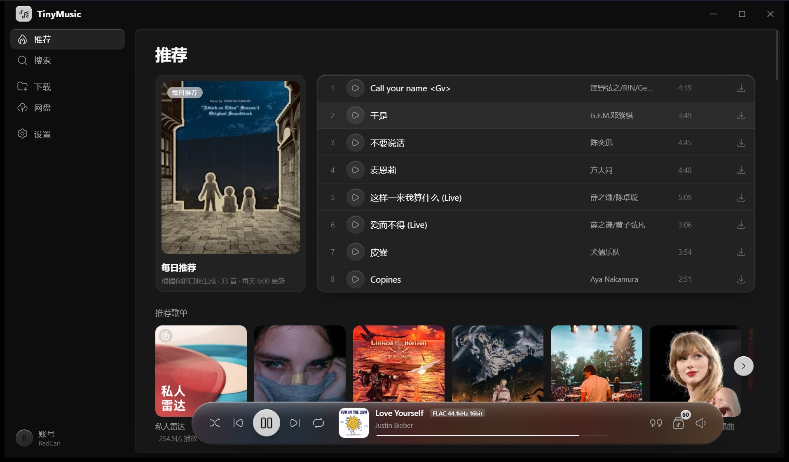

# TinyMusic

一个 4.5 MB 的桌面音乐客户端。搜索、试听、下载、歌词、网盘，都在一个窗口里。

**[官网与下载](https://redcarl.github.io/TinyMusic/)** · **[源码](https://github.com/RedCarl/TinyMusic)** · **[问题反馈](https://github.com/RedCarl/TinyMusic/issues)**



---

## 这是什么

TinyMusic 是一个 Windows / macOS 上的音乐客户端。它把「找歌 → 听歌 → 留下来」放进同一个窗口：搜索平台曲库、在线播放、下载到本地或自己的网盘，歌词、封面、歌单一并处理。

它不是在线音乐服务，也不替代平台会员。曲目来自平台网页端的接口，能拿到的正常播，拿不到的会明确标出来并置灰——不会让你盯着「正在搜索」等一个永远不会来的结果。

---

## 能做什么

### 搜索与浏览

- 歌曲、专辑、歌手、歌单搜索，结果按热度排序
- 歌手页：头像、基本资料、简介、专辑与曲目
- 专辑页、歌单页：整张播放、批量下载
- 搜索结果里的「该歌手的专辑」横向卡片，点封面直接进专辑

### 播放

- 悬浮播放器栏：随机、循环、音量、播放队列
- 全屏歌词页：逐行高亮，点任意一句从那里开始播
- 歌词、队列、音质、下载、歌曲详情都在右键菜单里
- 重开应用会恢复上次的曲目和进度，但不会突然出声

### 音质

- 标准 128k、高品质 320k、无损 FLAC
- 能不能播在点之前就判断好，没无损的曲目直接禁用无损
- 实际格式按文件本身确认，被降级了会明确标注

### 下载

- 下载时尽量把封面和歌词一起带上，换设备、车载播放器也能正常显示
- 专辑、歌单、搜索结果、喜欢列表都能「下载全部」
- 下载、收藏、批量导入都有真实的进度显示
- 可以存到本地，也可以直接传进你自己的网盘

### 网盘（可选）

- 兼容 AWS S3、MinIO、Cloudflare R2 等 S3 协议服务
- 每个歌单对应桶里的一个目录，可新建、重命名、排序、删除、整张播放
- 「喜欢」的歌曲会同步到网盘，换电脑后自动合并
- 平台歌单可以一键导入网盘，任务在后台排队跑，不用守着窗口

### 账号（可选）

- 酷我、网易云都支持网页登录，登录只是为了拿歌单和每日推荐
- 不保存密码，登录状态只留在这台电脑上

### 其他

- 关闭窗口默认收进系统托盘，播放不中断（可以在设置里改）
- 跟随系统的浅色 / 深色主题，也可以手动指定
- 应用内检查更新并直接升级
- 常用操作都能右键找到，不用记路径

---

## 下载与安装

安装包都在这一个页面：**<https://redcarl.github.io/TinyMusic/>**

| 平台 | 要求 |
|---|---|
| Windows | Windows 10 / 11，64 位 |
| macOS | macOS 11 及以上，Apple 芯片或 Intel |

- 安装包约 3–4 MB，新版本可以在「设置 → 版本」里检查更新
- macOS 首次打开若提示「已损坏」，在 Finder 里右键选择「打开」即可（安装包没有做 Apple 公证）
- Windows 安装包暂未做代码签名，SmartScreen 若提示「未知发布者」，选择「仍要运行」
- 历史版本都在 [GitHub Releases](https://github.com/RedCarl/TinyMusic/releases)

---

## 常见问题

**为什么有些歌是灰色的？**

平台没有给出能播的完整音源：会员专享、已下架，或者接口这次没拿到，都会标成不可用。这个客户端不绕过平台权限，也不做「假装能播」。

**为什么没有 Hi-Res、杜比全景声、母带？**

这三档需要平台会员权益，音频还是加密下发的，公开接口拿不到。所以直接置灰，而不是让你点了才失败。

**登录能解锁会员歌吗？**

不能。登录主要用来拿每日推荐、个人歌单和资料库。平台会员专属的内容仍然需要平台会员。

**下载的文件在哪？**

默认下载目录可以在「设置」里改。一般会生成音频 + 同名 `.lrc` 歌词，封面会尽量写进音频文件里。

**我的数据存在哪？**

设置、下载记录、收藏都在这台电脑上，账号状态也只在本机。开启网盘后，「喜欢」列表和下载的歌只会发到你自己的存储桶，不会上传到任何别的地方。

**会不会动到我的平台账号？**

不会。客户端只读公开数据；需要登录的操作（看自己的歌单）用的是你自己的浏览器登录态，存在本机。

---

## 免责声明

- 本项目是**非官方**客户端，与酷我音乐、网易云音乐及其关联公司没有隶属关系，也不代表它们。
- 只调用平台公开的 HTTP 接口，**不包含、不分发**平台的任何客户端程序或音频资源，也不破解版权保护。
- 曲库、音频、封面、歌词的版权归各平台及权利人所有。本软件仅供学习、研究与个人使用，**不得用于商业用途**，也不得用于传播或再分发相关内容。
- 平台接口属于非公开协议，随时可能变更或失效；因此导致的功能不可用不构成任何承诺。
- 使用本软件产生的任何后果由使用者自行承担。

---

## 更多

- 源码与问题反馈：<https://github.com/RedCarl/TinyMusic>
- 如果它好用，欢迎点个 Star。
- 给开发者看的技术细节在 [`docs/`](docs/)：音质调研、界面材质、音源扩展。

<details>
<summary>开发与构建</summary>

```bash
pnpm install
pnpm tauri dev          # 开发
pnpm tauri build        # 打包

cargo test -p tinymusic-core   # 协议层测试，不需要 Tauri
```

需要 Node.js、pnpm 和 Rust 工具链。

</details>
